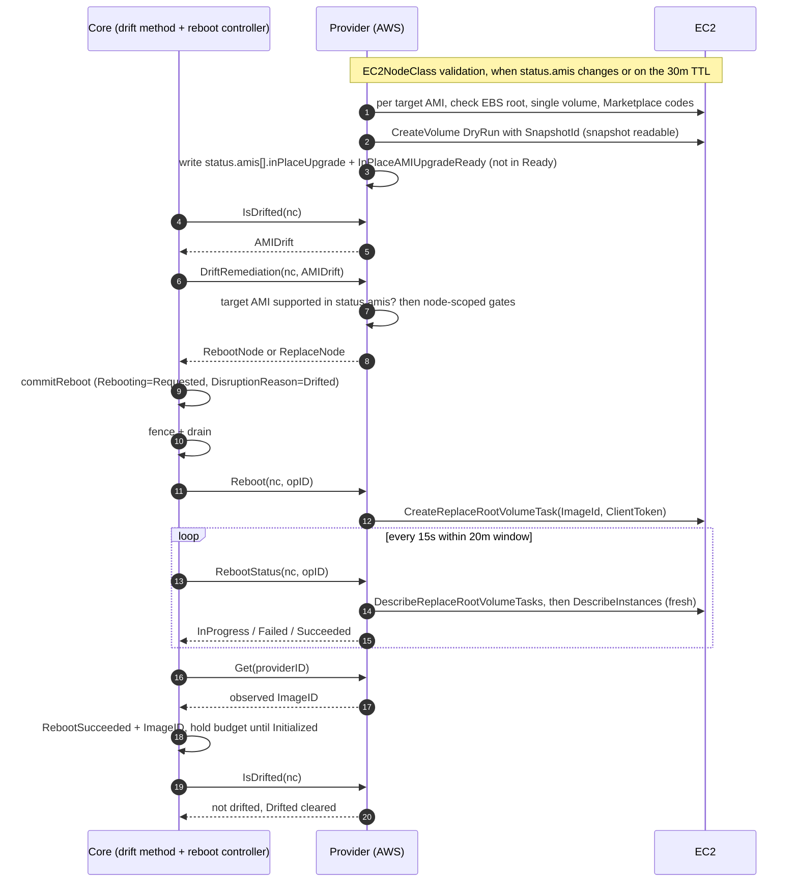

# In-Place AMI Upgrade: core / provider sequencing

## More in depth

### 1. DriftRemediation
Core only sees "AMIDrift". It can't know whether an in-place swap is safe for this node: hidden SG drift, a family or version change, a RAID0 layout, or an unreadable snapshot can all make it unsafe. It has to decide before committing, because committing drains the node. So the provider answers that question up front, and anything unsafe falls back to today's replace.

It returns `RebootNode` or `ReplaceNode`. `RebootNode` means "safe to do in place": core commits the node to the reboot lifecycle with `DisruptionReason=Drifted`, and skips scheduling simulation and the replacement. `ReplaceNode` means "not safe, or not opted in": core takes today's drift path, which simulates, pre-spins a replacement and terminates the node. Every "no" also emits an event naming the gate that failed. That way operators can see why a node was replaced instead of upgraded in place.

The image-scoped checks don't depend on the node, so EC2NodeClass validation precomputes them once per AMI and writes the verdict into `status.amis[].inPlaceUpgrade`:
- EBS root, no Marketplace codes, single volume;
- no AL2023 + RAID0;
- snapshot readable and IAM allowed.

It also sets an `InPlaceAMIUpgradeReady` condition. That condition is kept out of `Ready`, so an RVR problem never blocks provisioning, and operators see it as soon as a new AMI resolves. The snapshot check is a `CreateVolume` dry run with the target's root `SnapshotId`, which needs no instance. It has to use the snapshot, not the image, because an image-based dry run passes even when the snapshot is unreadable. A launch-only shared AMI is the common case: it launches fine but can't be used for RVR.

At drift time, `DriftRemediation` only looks up the node's target AMI in that status. It then checks what is specific to this node: the AMI is the only drift, the family, variant and K8s minor version are unchanged, the instance is running, and a TGP is set.

### 2. Reboot
`Reboot()` carries no "which action" field, so the provider works it out from the NodeClaim it's handed. `DisruptionReason` says who committed the reboot: `Drifted` (drift) or `Unhealthy` (repair). The `Drifted` condition and the NodeClass say whether this node is AMI-drifted and opted in. The provider then re-runs the same gates `DriftRemediation` used:
- `Drifted` and the gates pass: `CreateReplaceRootVolumeTask`.
- `Unhealthy` but also AMI-drifted and eligible: `CreateReplaceRootVolumeTask`, which fixes the fault and the drift in one go.
- Anything else: `RebootInstances`.

This works because `DisruptionReason` stays on the NodeClaim for the whole reboot, so no new annotation or interface field is needed.

### 3. RebootStatus loop
A new boot ID plus Ready only proves the node restarted, not that the swap took effect. A failed task that reboots on the old root looks identical, and so does EC2 not having caught up yet. Only the provider's task state can tell these apart, so core waits for the provider to confirm, and fails fast when the provider reports a failure instead of waiting out 20 minutes.

### 4. Get
Core writes `Status.ImageID` only at launch, so without a refresh the node stays drifted forever. Reading it back from the provider after confirmation records the image the node is actually running, not the one we intended. That's what lets drift clear honestly and avoids false patch compliance.
